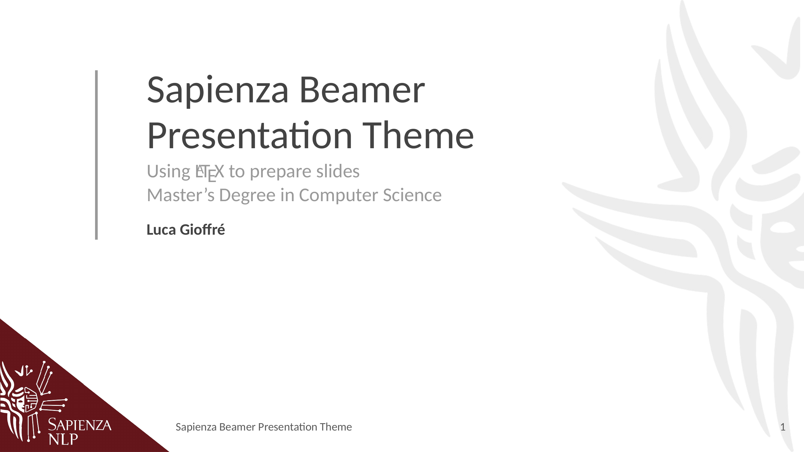
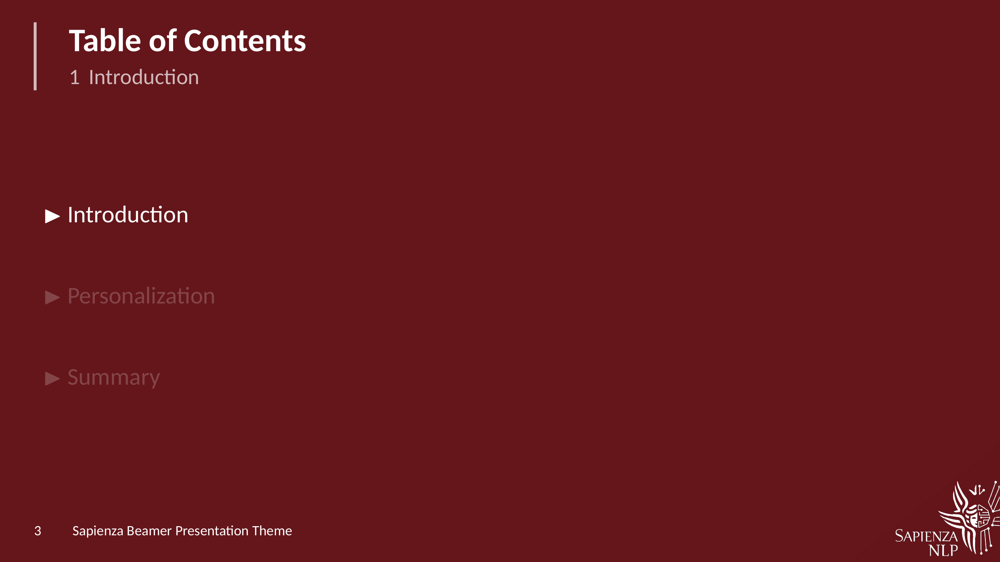
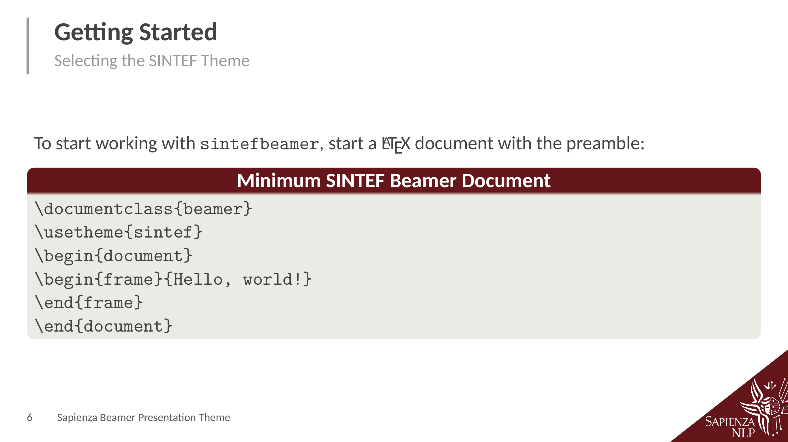
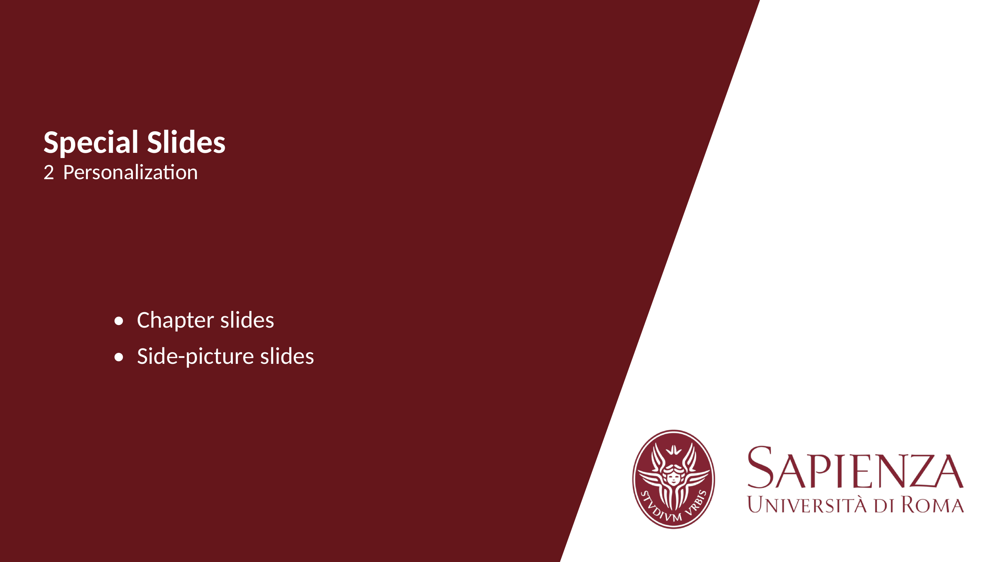
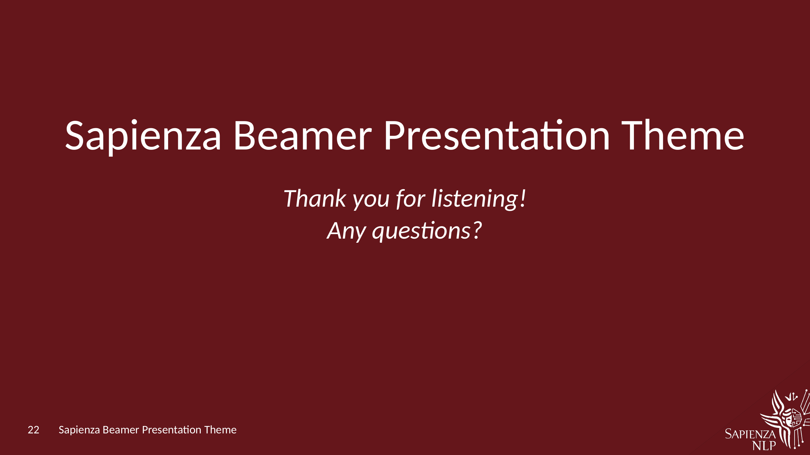

# Sapienza NLP Beamer Presentation Template

This is a Latex template to create slides with LaTeX beamer for Sapienza University of Rome, restyled after the Sapienza NLP slide layout.

It is a fork of [sapienza-beamer-template](https://github.com/andrea-gasparini/sapienza-beamer-template) by Andrea Gasparini. The original template is available on Overleaf Gallery and can be used directly by clicking on "Open as Template" from [here](https://www.overleaf.com/latex/templates/sapienza-presentation/yyksmrskffhk).

## Options

* `noslidenumber`: disable slide numbering
* `nocorners`: no corner triangles on any slide
* `nopicturecorners`: no corner triangles over pictures (side-picture slides, full-screen title background)

Example:

```tex
\usetheme[noslidenumber,nopicturecorners]{sintef}
```

## Sapienza NLP layout

Every slide has a triangle with the Sapienza NLP logo in the lower-right corner, the slide number at the bottom left, and frame titles with a grey bar on their left. The title slide has the triangle in the lower-left corner and a faded emblem on the right.

The decorations are vector PDFs in `assets/` (`decor_frame.pdf`, `decor_title.pdf`, `decor_watermark.pdf`), extracted from the Google Slides layout.

Commands:

* `\footertext{...}`: text shown next to the slide number. Optional; without it only the number is shown.
* `\cornersoff` / `\cornerson`, `\picturecornersoff` / `\picturecornerson`: the same switches as the `nocorners` and `nopicturecorners` options, usable anywhere in the document; they apply from the next slide on.
* `\begin{frame}[nocorner]{...}`: no corner triangle on that slide only (also `\begin{sidepic}[nocorner]{<image>}{<title>}`). Chapter slides never have it.
* `\cornerscale{0.7}`: size of the corner triangles relative to the Google Slides layout (default `0.7`; `1` is the original size).
* `\titlebackground{img}` / `\titlebackground*{img}`: still supported; the picture replaces the faded emblem on the title slide.
* `\footlinecolor{color}`: now only sets the colour of blocks, since the footer is no longer a coloured band.

## Screenshots

### Title page



### Table of Contents



### Code blocks



### Chapter slides



### Final thanks



---

This template is based on [SINTEF Presentation](https://www.overleaf.com/latex/templates/sintef-presentation/jhbhdffczpnx) from [Federico Zenith](mailto:federico.zenith@sintef.no) and some addition are inspired by its derivation [Beamer-LaTeX-Themes](https://github.com/TOB-KNPOB/Beamer-LaTeX-Themes) from Liu Qilong
